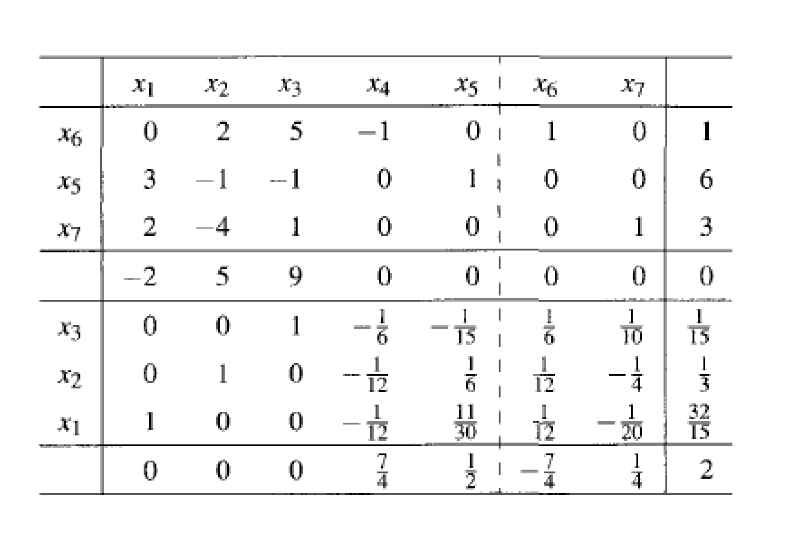
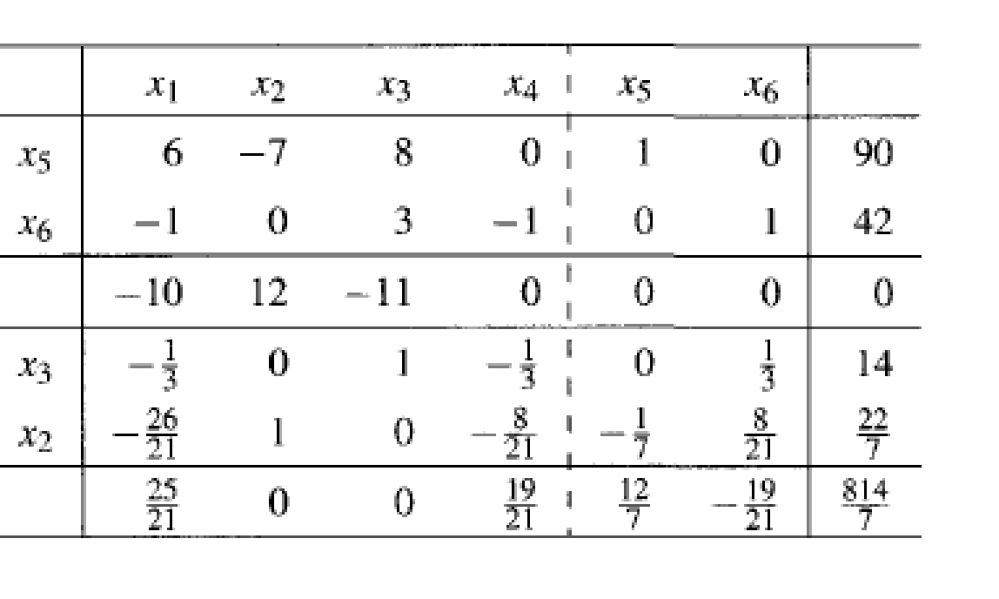

# THQ #5
### By: Ethan Le :D

## Question 1

#### Objective Function:

$$\boldsymbol{\min} \; -2x_1 + 5x_2 + 9x_3$$

#### Constraints:
- $2x_2 + 5x_3 \geq 1$
- $3x_1 - x_2 - x_3 \leq 6$
- $2x_1 - 4x_2 + x_3 = 3$
- $x_1, x_2, x_3 \geq 0 \qquad \textbf{(non-negative)}$

From the initial tableau, the extra columns are:

- $x_4$: surplus for $2x_2 + 5x_3 \geq 1$
- $x_5$: slack for $3x_1 - x_2 - x_3 \leq 6$
- $x_6$: artificial for the $\geq$ constraint
- $x_7$: artificial for the equality

Initial basic variables: $x_6$, $x_5$, $x_7$.

### Given Tableaux:

### Dual:

The primal is a minimization, so the dual is a maximization. The objective coefficients are the primal right-hand sides, $1$, $6$, and $3$. Since $x_1, x_2, x_3 \geq 0$, each dual constraint is $\leq$.

#### Objective Function:

$$\boldsymbol{\max} \; y_1 + 6y_2 + 3y_3$$

#### Constraints:
- $3y_2 + 2y_3 \leq -2$
- $2y_1 - y_2 - 4y_3 \leq 5$
- $5y_1 - y_2 + y_3 \leq 9$
- $y_1 \geq 0$ because the first primal constraint is $\geq$
- $y_2 \leq 0$ because the second primal constraint is $\leq$
- $y_3$ unrestricted because the third primal constraint is an equality

### Optimal value (primal and dual):

The final tableau is optimal, so strong duality applies: the primal minimum and the dual maximum are equal. The bottom-right entry is $2$, and that entry is the negative of the objective value, so

$$z^* = -2$$

for both the primal and the dual.

### Optimal primal solution:

From the final tableau, the basic variables are $x_1$, $x_2$, and $x_3$. Their values are the right-hand side of that tableau, and every nonbasic variable is $0$:

$$(x_1, x_2, x_3) = \left(\frac{32}{15}, \frac{1}{3}, \frac{1}{15}\right).$$

Plugging this point into the primal objective confirms the value above:

$$-2\left(\frac{32}{15}\right) + 5\left(\frac{1}{3}\right) + 9\left(\frac{1}{15}\right) = -\frac{64}{15} + \frac{25}{15} + \frac{9}{15} = -2.$$

### Optimal dual solution:

The optimal dual point is read from the bottom row of the final tableau, under the columns that were the identity in the initial tableau. Those are the slack and artificial columns, one per primal constraint. Each bottom-row entry there is the negative of the corresponding dual variable.

- First constraint, artificial $x_6$: bottom entry $-\dfrac{7}{4}$, so $y_1 = -\left(-\dfrac{7}{4}\right) = \dfrac{7}{4}$.
- Second constraint, slack $x_5$: bottom entry $\dfrac{1}{2}$, so $y_2 = -\dfrac{1}{2}$.
- Third constraint, artificial $x_7$: bottom entry $\dfrac{1}{4}$, so $y_3 = -\dfrac{1}{4}$.

$$(y_1, y_2, y_3) = \left(\frac{7}{4}, -\frac{1}{2}, -\frac{1}{4}\right).$$

These signs match the dual restrictions: $y_1 \geq 0$, $y_2 \leq 0$, and $y_3$ unrestricted. The dual objective agrees with the shared optimal value:

$$\frac{7}{4} + 6\left(-\frac{1}{2}\right) + 3\left(-\frac{1}{4}\right) = \frac{7}{4} - 3 - \frac{3}{4} = -2.$$

## Question 2

#### Objective Function:

$$\boldsymbol{\max} \; 10x_1 - 12x_2 + 11x_3$$

#### Constraints:
- $6x_1 - 7x_2 + 8x_3 = 90$
- $-x_1 + 3x_3 \geq 42$
- $x_1, x_2, x_3 \geq 0 \qquad \textbf{(non-negative)}$

The objective row in the tableaux is the minimized form of this problem: minimizing $-10x_1 + 12x_2 - 11x_3$.

From the initial tableau, the extra columns are:

- $x_4$: surplus for $-x_1 + 3x_3 \geq 42$
- $x_5$: artificial for the equality
- $x_6$: artificial for the $\geq$ constraint

Initial basic variables: $x_5$, $x_6$.

### Given Tableaux:

### Dual:

The primal is a maximization, so the dual is a minimization. The objective coefficients are the primal right-hand sides, $90$ and $42$. Since $x_1, x_2, x_3 \geq 0$, each dual constraint is $\geq$. There are two primal constraints, so the dual has only $y_1$ and $y_2$.

#### Objective Function:

$$\boldsymbol{\min} \; 90y_1 + 42y_2$$

#### Constraints:
- $6y_1 - y_2 \geq 10$
- $-7y_1 \geq -12$
- $8y_1 + 3y_2 \geq 11$
- $y_1$ unrestricted because the first primal constraint is an equality
- $y_2 \leq 0$ because the second primal constraint is $\geq$

### Optimal value (primal and dual):

The final tableau is optimal, so strong duality applies: the primal maximum and the dual minimum are equal. The bottom-right entry of the final tableau is the optimal value of the original maximize problem, so

$$z^* = \frac{814}{7}$$

for both the primal and the dual.

### Optimal primal solution:

From the final tableau, $x_2$ and $x_3$ are basic and $x_1$ is nonbasic, so

$$(x_1, x_2, x_3) = \left(0, \frac{22}{7}, 14\right).$$

### Optimal dual solution:

The optimal dual point is read from the bottom row of the final tableau, under the artificial columns that were the identity in the initial tableau. The tableau minimizes the negative of the original objective, so those entries are copied as written. No extra sign flip.

- First constraint, artificial $x_5$: bottom entry $\dfrac{12}{7}$, so $y_1 = \dfrac{12}{7}$.
- Second constraint, artificial $x_6$: bottom entry $-\dfrac{19}{21}$, so $y_2 = -\dfrac{19}{21}$.

$$(y_1, y_2) = \left(\frac{12}{7}, -\frac{19}{21}\right).$$

These signs match the dual restrictions: $y_1$ is unrestricted and $y_2 \leq 0$. The dual objective agrees with the shared optimal value:

$$90\left(\frac{12}{7}\right) + 42\left(-\frac{19}{21}\right) = \frac{1080}{7} - 38 = \frac{814}{7}.$$

