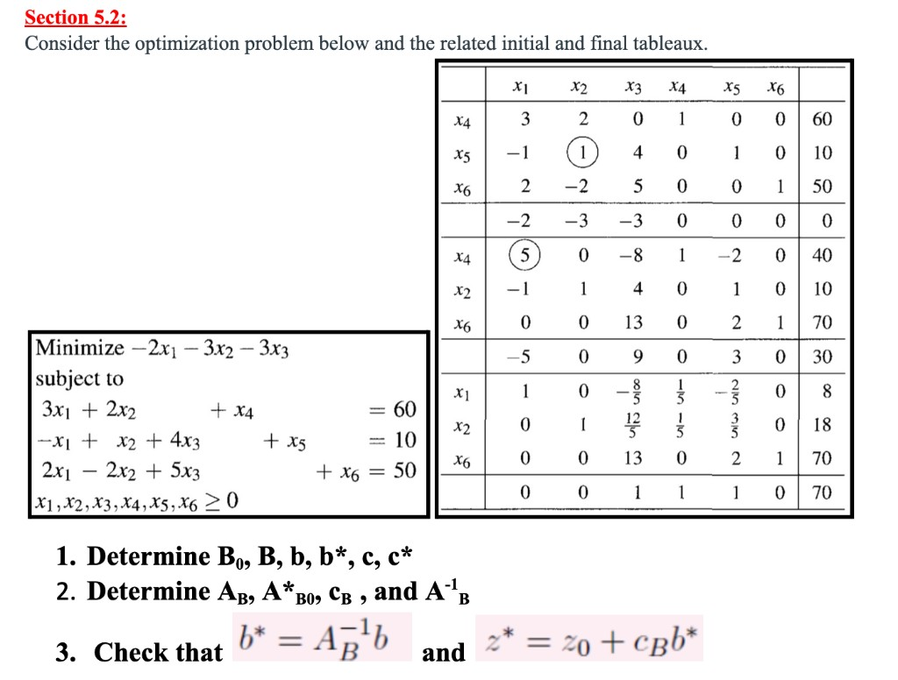
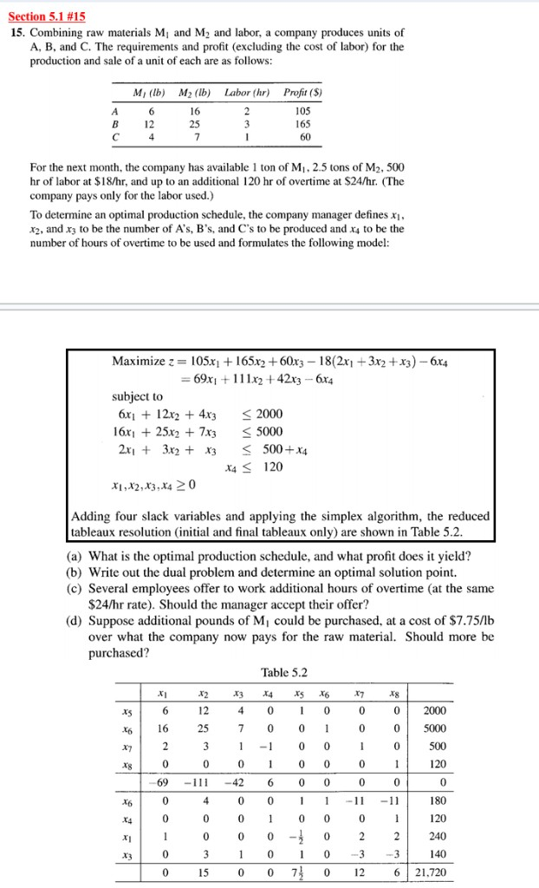

# THQ #6
### By: Ethan Le :D

## Question 1 (Section 5.2)

#### Objective Function:

$$\boldsymbol{\min} \; -2x_1 - 3x_2 - 3x_3$$

#### Constraints:
- $3x_1 + 2x_2 + x_4 = 60$
- $-x_1 + x_2 + 4x_3 + x_5 = 10$
- $2x_1 - 2x_2 + 5x_3 + x_6 = 50$
- $x_1, x_2, x_3, x_4, x_5, x_6 \geq 0 \qquad \textbf{(non-negative)}$

### Given Tableaux:

### Tasks:

1. Determine $B_0$, $B$, $b$, $b^*$, $c$, $c^*$.

$$B_0 = \{x_4, x_5, x_6\}, \qquad B = \{x_1, x_2, x_6\}$$

$$b = [60,\ 10,\ 50]^\top, \qquad b^* = [8,\ 18,\ 70]^\top$$

$c$ and $c^*$ are the bottom rows of the initial and final tableaux respectively:

$$c^\top = [-2,\ -3,\ -3,\ 0,\ 0,\ 0], \qquad {c^*}^\top = [0,\ 0,\ 1,\ 1,\ 1,\ 0]$$

2. Determine $A_B$, $A^*_{B_0}$, $c_B$, and $A_B^{-1}$.

$A_B$ = columns of $B = \{x_1, x_2, x_6\}$ in the initial tableau:

$$A_B = \begin{bmatrix} 3 & 2 & 0 \\ -1 & 1 & 0 \\ 2 & -2 & 1 \end{bmatrix}$$

$A_B^{-1} = A^*_{B_0}$ = columns of $B_0 = \{x_4, x_5, x_6\}$ in the final tableau:

$$A_B^{-1} = A^*_{B_0} = \begin{bmatrix} \dfrac{1}{5} & -\dfrac{2}{5} & 0 \\ \dfrac{1}{5} & \dfrac{3}{5} & 0 \\ 0 & 2 & 1 \end{bmatrix}$$

$c_B$ = the $c$-row entries for just the $B$ variables $\{x_1, x_2, x_6\}$:

$$c_B = [-2,\ -3,\ 0]^\top$$

3. Check that $b^* = A_B^{-1} b$ and $z^* = z_0 + c_B b^*$.

$$A_B^{-1} b = \begin{bmatrix} \dfrac{1}{5} & -\dfrac{2}{5} & 0 \\ \dfrac{1}{5} & \dfrac{3}{5} & 0 \\ 0 & 2 & 1 \end{bmatrix} \begin{bmatrix} 60 \\ 10 \\ 50 \end{bmatrix} = \begin{bmatrix} 12 - 4 \\ 12 + 6 \\ 20 + 50 \end{bmatrix} = \begin{bmatrix} 8 \\ 18 \\ 70 \end{bmatrix} = b^*$$

$$z_0 + c_B^\top b^* = 0 + [-2,\ -3,\ 0] \begin{bmatrix} 8 \\ 18 \\ 70 \end{bmatrix} = -16 - 54 = -70 = z^*$$

## Question 2 (Section 5.1 \#15)

A company produces units of $A$, $B$, and $C$ using raw materials $M_1$, $M_2$, and labor.

| | $A$ | $B$ | $C$ | Available |
|---|---|---|---|---|
| $M_1$ (lb) | 6 | 12 | 4 | 1 ton $= 2000$ lb |
| $M_2$ (lb) | 16 | 25 | 7 | 2.5 tons $= 5000$ lb |
| Labor (hr) | 2 | 3 | 1 | 500 hr at $\$18$/hr |
| Profit (\$) | 105 | 165 | 60 | |

Up to 120 overtime hours are available at $\$24$/hr.

Variables: $x_1, x_2, x_3$ = units of $A$, $B$, $C$; $x_4$ = overtime hours used.

#### Objective Function:

$$\boldsymbol{\max} \; z = 105x_1 + 165x_2 + 60x_3 - 18(2x_1 + 3x_2 + x_3) - 6x_4 = 69x_1 + 111x_2 + 42x_3 - 6x_4$$

#### Constraints:
- $6x_1 + 12x_2 + 4x_3 \leq 2000$
- $16x_1 + 25x_2 + 7x_3 \leq 5000$
- $2x_1 + 3x_2 + x_3 \leq 500 + x_4$
- $x_4 \leq 120$
- $x_1, x_2, x_3, x_4 \geq 0 \qquad \textbf{(non-negative)}$

### Given Tableaux (Table 5.2):

### Tasks:

(a) What is the optimal production schedule and profit?

From the final tableau, the basic variables are $x_1$, $x_3$, $x_4$ (and slack $x_6$), with $x_2$ nonbasic, so

$$(x_1, x_2, x_3, x_4) = (240,\ 0,\ 140,\ 120), \qquad z^* = 21720.$$

(b) Write the dual problem and determine the optimal solution point.

Rewrite the labor constraint as $2x_1 + 3x_2 + x_3 - x_4 \leq 500$. The primal is a maximization with all $\leq$ constraints and $x_j \geq 0$, so the dual is a minimization with all $\geq$ constraints and $y_i \geq 0$.

#### Dual Objective Function:

$$\boldsymbol{\min} \; 2000y_1 + 5000y_2 + 500y_3 + 120y_4$$

#### Dual Constraints:
- $6y_1 + 16y_2 + 2y_3 \geq 69$
- $12y_1 + 25y_2 + 3y_3 \geq 111$
- $4y_1 + 7y_2 + y_3 \geq 42$
- $-y_3 + y_4 \geq -6$
- $y_1, y_2, y_3, y_4 \geq 0 \qquad \textbf{(non-negative)}$

The optimal dual point is read from the bottom row of the final primal tableau under the slack columns $x_5, x_6, x_7, x_8$:

$$(y_1, y_2, y_3, y_4) = (7.5,\ 0,\ 12,\ 6).$$

Check against the dual objective (should match $z^* = 21720$):

$$2000(7.5) + 5000(0) + 500(12) + 120(6) = 15000 + 0 + 6000 + 720 = 21720.$$

(c) Should the manager accept an offer for more overtime hours at $\$24$/hr?

More overtime means raising the cap $x_4 \leq 120$. That constraint's slack is $x_8$, so its shadow price is the bottom-row entry under $x_8$, which is $y_4 = 6$.

Since $y_4 = 6 > 0$, one more overtime hour at $\$24$/hr (already in the model) increases profit by about $\$6$. So yes, the manager should accept.

(d) Should additional $M_1$ be purchased at a cost of $\$7.75$/lb over the current price?

$M_1$ is the first constraint, with slack $x_5$, so its shadow price is $y_1 = 7.5$. One more pound of $M_1$ is only worth about $\$7.50$, but the extra cost is $\$7.75 > 7.50$. So no, do not buy additional $M_1$.

## Question 3 (Section 5.3 \#9a \& c)

Same LP and tableaux as Question 2 (Section 5.1 \#15).

### Important info:

Initial basis (ordered to form the identity in $A$):

$$B_0 = [x_5,\ x_6,\ x_7,\ x_8]$$

Final basis (ordered to form the identity in $A^*$):

$$B = [x_6,\ x_4,\ x_1,\ x_3]$$

### Tasks:

(a) Determine how much the profit on a unit of $A$ (the $\$105$) can vary before the optimal production schedule would change.

Since $\$105$ correlates with the net objective coefficient $69$ for $x_1$, we replace $69$ by $69 + \varepsilon$.

$c_\lambda$ is the $z$-row of the initial tableau with that change (the $x_1$ entry becomes $-69-\varepsilon$):

$$c_\lambda^\top = [-69-\varepsilon,\ -111,\ -42,\ 6,\ 0,\ 0,\ 0,\ 0]$$

$$c_{\lambda B}^\top = [0,\ 6,\ -69-\varepsilon,\ -42]$$

$$c_\lambda^* = c_\lambda - c_{\lambda B} A^*$$

$$
=
\begin{bmatrix} -69-\varepsilon & -111 & -42 & 6 & 0 & 0 & 0 & 0 \end{bmatrix}
-
\begin{bmatrix} 0 & 6 & -69-\varepsilon & -42 \end{bmatrix}
\begin{bmatrix}
0 & 4 & 0 & 0 & 1 & 1 & -11 & -11 \\
0 & 0 & 0 & 1 & 0 & 0 & 0 & 1 \\
1 & 0 & 0 & 0 & -\dfrac{1}{2} & 0 & 2 & 2 \\
0 & 3 & 1 & 0 & 1 & 0 & -3 & -3
\end{bmatrix}
$$

Matrix multiplication $c_{\lambda B} A^*$:

$$c_{\lambda B} A^* = [-69-\varepsilon,\ -126,\ -42,\ 6,\ -7.5+\tfrac{1}{2}\varepsilon,\ 0,\ -12-2\varepsilon,\ -6-2\varepsilon]$$

Subtract from $c_\lambda$:

$$c_\lambda^* = [0,\ 15,\ 0,\ 0,\ 7.5-\tfrac{1}{2}\varepsilon,\ 0,\ 12+2\varepsilon,\ 6+2\varepsilon]$$

Keep every entry $\geq 0$:

- $7.5 - \dfrac{1}{2}\varepsilon \geq 0 \implies \varepsilon \leq 15$
- $12 + 2\varepsilon \geq 0 \implies \varepsilon \geq -6$
- $6 + 2\varepsilon \geq 0 \implies \varepsilon \geq -3$

The binding bounds are $-3 \leq \varepsilon \leq 15$, so the sale profit on $A$ can range from

$$\$102 \leq 105+\varepsilon \leq \$120$$

before the optimal production schedule changes.

(c) Determine how much the profit on a unit of $C$ (the $\$60$) can vary before the optimal production schedule would change.

Since $\$60$ correlates with the net objective coefficient $42$ for $x_3$, we replace $42$ by $42 + \varepsilon$.

$c_\lambda$ is the $z$-row of the initial tableau with that change (the $x_3$ entry becomes $-42-\varepsilon$):

$$c_\lambda^\top = [-69,\ -111,\ -42-\varepsilon,\ 6,\ 0,\ 0,\ 0,\ 0]$$

$c_{\lambda B}$ is the same row, but only the final basis columns $B = [x_6,\ x_4,\ x_1,\ x_3]$:

$$c_{\lambda B}^\top = [0,\ 6,\ -69,\ -42-\varepsilon]$$

$$c_\lambda^* = c_\lambda - c_{\lambda B} A^*$$

$$
=
\begin{bmatrix} -69 & -111 & -42-\varepsilon & 6 & 0 & 0 & 0 & 0 \end{bmatrix}
-
\begin{bmatrix} 0 & 6 & -69 & -42-\varepsilon \end{bmatrix}
\begin{bmatrix}
0 & 4 & 0 & 0 & 1 & 1 & -11 & -11 \\
0 & 0 & 0 & 1 & 0 & 0 & 0 & 1 \\
1 & 0 & 0 & 0 & -\dfrac{1}{2} & 0 & 2 & 2 \\
0 & 3 & 1 & 0 & 1 & 0 & -3 & -3
\end{bmatrix}
$$

Matrix multiplication $c_{\lambda B} A^*$:

$$c_{\lambda B} A^* = [-69,\ -126-3\varepsilon,\ -42-\varepsilon,\ 6,\ -7.5-\varepsilon,\ 0,\ -12+3\varepsilon,\ -6+3\varepsilon]$$

Subtract from $c_\lambda$:

$$c_\lambda^* = [0,\ 15+3\varepsilon,\ 0,\ 0,\ 7.5+\varepsilon,\ 0,\ 12-3\varepsilon,\ 6-3\varepsilon]$$

Keep every entry $\geq 0$:

- $15 + 3\varepsilon \geq 0 \implies \varepsilon \geq -5$
- $7.5 + \varepsilon \geq 0 \implies \varepsilon \geq -7.5$
- $12 - 3\varepsilon \geq 0 \implies \varepsilon \leq 4$
- $6 - 3\varepsilon \geq 0 \implies \varepsilon \leq 2$

The binding bounds are $-5 \leq \varepsilon \leq 2$, so the sale profit on $C$ can range from

$$\$55 \leq 60+\varepsilon \leq \$62$$

before the optimal production schedule changes.

## Question 4 (Section 5.5 \#7)

Same LP and tableaux as Question 2 (Section 5.1 \#15).

### Important info:

$$B_0 = [x_5,\ x_6,\ x_7,\ x_8], \qquad B = [x_6,\ x_4,\ x_1,\ x_3]$$

$$A_B^{-1} = A^*_{B_0} = \text{final-tableau columns under } x_5,x_6,x_7,x_8$$

These are **RHS / $b$-changes** (handout page 5: “For $\lambda$ change in RHS → $b$-entries”), not objective $c$-changes like Question 3.

### Tasks:

(a) Suppose $(500+\lambda)$ hr of labor at $\$18$/hr can be used, with $-16 \leq \lambda \leq 16$, and no other data change. Determine the optimal production schedule and profit.

**Method:**
1. Replace the labor RHS by $500+\lambda$, so
   $$b_\lambda = [2000,\ 5000,\ 500+\lambda,\ 120]^\top.$$
2. The given interval means the current basis stays optimal, so recompute
   $$b_\lambda^* = A_B^{-1} b_\lambda.$$

From the final tableau, columns under $x_5,x_6,x_7,x_8$ (rows ordered as $B = [x_6,x_4,x_1,x_3]$):

$$A_B^{-1} = \begin{bmatrix} 1 & 1 & -11 & -11 \\ 0 & 0 & 0 & 1 \\ -\dfrac{1}{2} & 0 & 2 & 2 \\ 1 & 0 & -3 & -3 \end{bmatrix}$$

$$
b_\lambda^* =
\begin{bmatrix} 1 & 1 & -11 & -11 \\ 0 & 0 & 0 & 1 \\ -\dfrac{1}{2} & 0 & 2 & 2 \\ 1 & 0 & -3 & -3 \end{bmatrix}
\begin{bmatrix} 2000 \\ 5000 \\ 500+\lambda \\ 120 \end{bmatrix}
=
\begin{bmatrix}
1(2000)+1(5000)-11(500+\lambda)-11(120) \\
120 \\
-\tfrac{1}{2}(2000)+2(500+\lambda)+2(120) \\
1(2000)-3(500+\lambda)-3(120)
\end{bmatrix}
=
\begin{bmatrix}
180-11\lambda \\
120 \\
240+2\lambda \\
140-3\lambda
\end{bmatrix}
$$

So with basics ordered $[x_6,x_4,x_1,x_3]$:

$$b_\lambda^* = [180-11\lambda,\ 120,\ 240+2\lambda,\ 140-3\lambda]^\top.$$

3. Read the new production schedule from $b_\lambda^*$ (same basic variables $x_6,x_4,x_1,x_3$; nonbasics stay $0$).

$$(x_1, x_2, x_3, x_4) = (240+2\lambda,\ 0,\ 140-3\lambda,\ 120)$$

(valid for $-16 \leq \lambda \leq 16$).

4. Get the new profit from $z_\lambda^* = z_0 + c_B^\top b_\lambda^*$.

Using the max-form costs for $B = [x_6,x_4,x_1,x_3]$:

$$c_B^\top = [0,\ -6,\ 69,\ 42], \qquad z_0 = 0$$

$$
\begin{aligned}
z_\lambda^*
&= [0,\ -6,\ 69,\ 42]
\begin{bmatrix} 180-11\lambda \\ 120 \\ 240+2\lambda \\ 140-3\lambda \end{bmatrix} \\
&= -6(120) + 69(240+2\lambda) + 42(140-3\lambda) \\
&= -720 + 16560 + 138\lambda + 5880 - 126\lambda \\
&= 21720 + 12\lambda.
\end{aligned}
$$

Check: plug the schedule into the max objective:

$$69(240+2\lambda) + 42(140-3\lambda) - 6(120) = 21720 + 12\lambda.$$

At $\lambda = 0$, this is $21720$, matching the original final tableau.

(b) With 1 ton of $M_1$ available, its marginal value is $\$7.50$/lb. For what interval around $2000$ lb does $M_1$ keep this marginal value?

Marginal value $=$ shadow price $y_1 = 7.5$ (slack $x_5$ bottom-row entry).
Since $R_1$ (the $M_1$ constraint) correlates to slack $x_5$, replace the $M_1$ RHS by $2000+\varepsilon$:
   $$b_\varepsilon = [2000+\varepsilon,\ 5000,\ 500,\ 120]^\top.$$
Compute $b_\varepsilon^* = A_B^{-1} b_\varepsilon$ and require every entry $\geq 0$.

$$
b_\varepsilon^* =
\begin{bmatrix} 1 & 1 & -11 & -11 \\ 0 & 0 & 0 & 1 \\ -\dfrac{1}{2} & 0 & 2 & 2 \\ 1 & 0 & -3 & -3 \end{bmatrix}
\begin{bmatrix} 2000+\varepsilon \\ 5000 \\ 500 \\ 120 \end{bmatrix}
=
\begin{bmatrix}
1(2000+\varepsilon)+1(5000)-11(500)-11(120) \\
120 \\
-\tfrac{1}{2}(2000+\varepsilon)+2(500)+2(120) \\
1(2000+\varepsilon)-3(500)-3(120)
\end{bmatrix}
=
\begin{bmatrix}
180+\varepsilon \\
120 \\
240-\tfrac{1}{2}\varepsilon \\
140+\varepsilon
\end{bmatrix}
$$

Require $b_\varepsilon^* \geq 0$:

- $180+\varepsilon \geq 0 \implies \varepsilon \geq -180$
- $120 \geq 0$ always
- $240-\tfrac{1}{2}\varepsilon \geq 0 \implies \varepsilon \leq 480$
- $140+\varepsilon \geq 0 \implies \varepsilon \geq -140$

Binding bounds: $-140 \leq \varepsilon \leq 480$.

That $\varepsilon$-interval is the range of $M_1$ availability where the $\$7.50$/lb shadow price remains valid:

$$1860 \leq 2000+\varepsilon \leq 2480 \text{ lb of } M_1.$$
