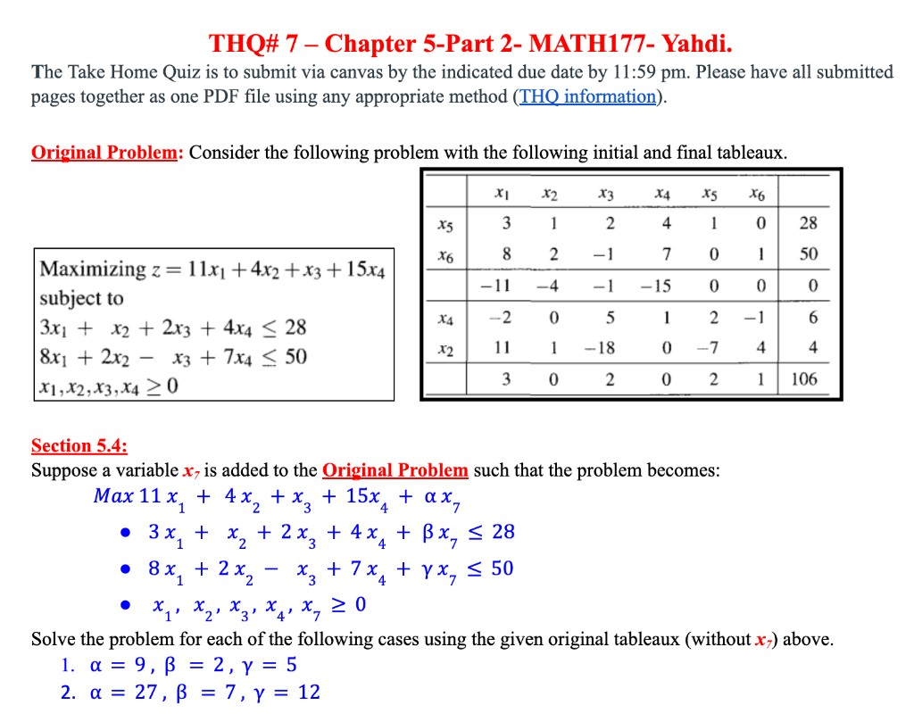

# THQ #7
### By: Ethan Le :D

## Original Problem

#### Objective Function:

$$\boldsymbol{\max} \; z = 11x_1 + 4x_2 + x_3 + 15x_4$$

#### Constraints:
- $3x_1 + x_2 + 2x_3 + 4x_4 \leq 28$
- $8x_1 + 2x_2 - x_3 + 7x_4 \leq 50$
- $x_1, x_2, x_3, x_4 \geq 0 \qquad \textbf{(non-negative)}$

### Given Tableaux (initial and final):

(In the tableaux, $x_5$ and $x_6$ are the slack variables for the two constraints.)

Initial basis (ordered to form the identity in $A$):

$$B_0 = [x_5,\ x_6]$$

Final basis (ordered to form the identity in $A^*$):

$$B = [x_4,\ x_2]$$

$$A_B^{-1} = A^*_{B_0} = \text{final-tableau columns under } x_5, x_6:$$

$$A_B^{-1} = A^*_{B_0} = \begin{bmatrix} 2 & -1 \\ -7 & 4 \end{bmatrix}$$

## Question 1 (Section 5.4)

Suppose a new variable $x_7$ is added to the original problem such that the problem becomes:

#### Objective Function:

$$\boldsymbol{\max} \; 11x_1 + 4x_2 + x_3 + 15x_4 + \alpha x_7$$

#### Constraints:
- $3x_1 + x_2 + 2x_3 + 4x_4 + \beta x_7 \leq 28$
- $8x_1 + 2x_2 - x_3 + 7x_4 + \gamma x_7 \leq 50$
- $x_1, x_2, x_3, x_4, x_7 \geq 0 \qquad \textbf{(non-negative)}$

Solve the problem for each of the following cases using the given original tableaux (without $x_7$) above.

### Tasks:

Using the handout (Section 5.4) with the **tableau / minimize** $c$-row (initial bottom row is $-\text{max coeffs}$):

- $c_B^\top = [-15,\ -4]$ for $B = [x_4,\ x_2]$
- $c_{n+1} = -\alpha$
- If $c^*_{n+1} \geq 0$ → $x_7$ stays out, current BFS remains optimal
- If $c^*_{n+1} < 0$ → enter $x_7$ and pivot

1. $\alpha = 9$, $\beta = 2$, $\gamma = 5$

$$A_{n+1} = \begin{bmatrix} \beta \\ \gamma \end{bmatrix} = \begin{bmatrix} 2 \\ 5 \end{bmatrix}$$

$$A^*_{n+1} = A_B^{-1} A_{n+1} = \begin{bmatrix} 2 & -1 \\ -7 & 4 \end{bmatrix} \begin{bmatrix} 2 \\ 5 \end{bmatrix} = \begin{bmatrix} 4-5 \\ -14+20 \end{bmatrix} = \begin{bmatrix} -1 \\ 6 \end{bmatrix}$$

$$c_{n+1} = -\alpha = -9, \qquad c_B^\top = [-15,\ -4]$$

$$c^*_{n+1} = c_{n+1} - c_B^\top A^*_{n+1} = -9 - [-15,\ -4]\begin{bmatrix} -1 \\ 6 \end{bmatrix} = -9 - (15-24) = -9 - (-9) = 0$$

Since $c^*_{n+1} = 0 \geq 0$, $x_7$ is not a basic variable ($x_7 = 0$) and the current BFS remains optimal:

$$(x_1, x_2, x_3, x_4, x_7) = (0,\ 4,\ 0,\ 6,\ 0), \qquad z^* = 106.$$

2. $\alpha = 27$, $\beta = 7$, $\gamma = 12$

$$A_{n+1} = \begin{bmatrix} \beta \\ \gamma \end{bmatrix} = \begin{bmatrix} 7 \\ 12 \end{bmatrix}$$

$$A^*_{n+1} = A_B^{-1} A_{n+1} = \begin{bmatrix} 2 & -1 \\ -7 & 4 \end{bmatrix} \begin{bmatrix} 7 \\ 12 \end{bmatrix} = \begin{bmatrix} 14-12 \\ -49+48 \end{bmatrix} = \begin{bmatrix} 2 \\ -1 \end{bmatrix}$$

$$c_{n+1} = -\alpha = -27, \qquad c_B^\top = [-15,\ -4]$$

$$c^*_{n+1} = c_{n+1} - c_B^\top A^*_{n+1} = -27 - [-15,\ -4]\begin{bmatrix} 2 \\ -1 \end{bmatrix} = -27 - (-30+4) = -27 - (-26) = -1$$

Since $c^*_{n+1} = -1 < 0$, enter $x_7$. Append its column to the final tableau (slack columns stay labeled $x_5,x_6$ as in the given tableaux):

$$
\begin{array}{c|cccccc|c|c}
 & x_1 & x_2 & x_3 & x_4 & x_5 & x_6 & x_7 & \text{RHS} \\
\hline
x_4 & -2 & 0 & 5 & 1 & 2 & -1 & 2 & 6 \\
x_2 & 11 & 1 & -18 & 0 & -7 & 4 & -1 & 4 \\
\hline
z & 3 & 0 & 2 & 0 & 2 & 1 & -1 & 106
\end{array}
$$

Ratio test on the entering column $[2,\ -1]^\top$:

- $x_4$: $6/2 = 3$
- $x_2$: $-1 < 0$, cannot leave

Pivot on the $2$: $x_7$ enters, $x_4$ leaves.

After the pivot (divide the $x_4$ row by $2$, then add that row to the $x_2$ and $z$ rows):

$$
\begin{array}{c|cccccc|c|c}
 & x_1 & x_2 & x_3 & x_4 & x_5 & x_6 & x_7 & \text{RHS} \\
\hline
x_7 & -1 & 0 & \dfrac{5}{2} & \dfrac{1}{2} & 1 & -\dfrac{1}{2} & 1 & 3 \\
x_2 & 10 & 1 & -\dfrac{31}{2} & \dfrac{1}{2} & -6 & \dfrac{7}{2} & 0 & 7 \\
\hline
z & 2 & 0 & \dfrac{9}{2} & \dfrac{1}{2} & 3 & \dfrac{1}{2} & 0 & 109
\end{array}
$$

All $z$-row entries are $\geq 0$, so this is optimal:

$$(x_1, x_2, x_3, x_4, x_7) = (0,\ 7,\ 0,\ 0,\ 3), \qquad z^* = 109.$$

Check: $4(7) + 27(3) = 28 + 81 = 109$.

## Question 2 (Section 5.6)

Suppose changes were made to the **Original Problem** (without $x_7$) such that $50$ in the RHS of the second constraint is changed to $50 + \lambda$.

Use the given original initial/final tableaux (and $A_B^{-1} = A^*_{B_0}$ from above).

### Tasks:

1. What is the new expression of $b_\lambda^*$ and $z_\lambda^*$?

$$b_\lambda = \begin{bmatrix} 28 \\ 50+\lambda \end{bmatrix}$$

$$
b_\lambda^* = A_B^{-1} b_\lambda =
\begin{bmatrix} 2 & -1 \\ -7 & 4 \end{bmatrix}
\begin{bmatrix} 28 \\ 50+\lambda \end{bmatrix}
=
\begin{bmatrix} 56-(50+\lambda) \\ -196+4(50+\lambda) \end{bmatrix}
=
\begin{bmatrix} 6-\lambda \\ 4+4\lambda \end{bmatrix}
$$

(Check at $\lambda = 0$: $b^* = [6,\ 4]^\top$, matching the final tableau.)

For $z_\lambda^*$, use the max-form costs of $B = [x_4,\ x_2]$ (handout: opposite sign if working from the min/tableau $c$-row):

$$c_B^\top = [15,\ 4], \qquad z_0 = 0$$

$$
\begin{aligned}
z_\lambda^*
&= z_0 + c_B^\top b_\lambda^*
= [15,\ 4]\begin{bmatrix} 6-\lambda \\ 4+4\lambda \end{bmatrix}
= 15(6-\lambda) + 4(4+4\lambda)
= 90 - 15\lambda + 16 + 16\lambda
= 106 + \lambda.
\end{aligned}
$$

Same result from the dual (shadow prices from the final $z$-row under $x_5,x_6$: $y = [2,\ 1]$):

$$z_\lambda^* = 28(2) + (50+\lambda)(1) = 56 + 50 + \lambda = 106 + \lambda.$$

2. Starting from the given tableaux above and with any additional tableaux if needed, solve for the optimal value and point if $\lambda = -2$.

Plug in $\lambda = -2$:

$$b_{-2}^* = \begin{bmatrix} 6-(-2) \\ 4+4(-2) \end{bmatrix} = \begin{bmatrix} 8 \\ -4 \end{bmatrix}, \qquad 106 + (-2) = 104.$$

The second basic value is negative, so the current basis is **not feasible**. Use the **dual simplex** algorithm on the final tableau with the updated RHS:

$$
\begin{array}{c|cccccc|c}
 & x_1 & x_2 & x_3 & x_4 & x_5 & x_6 & \text{RHS} \\
\hline
x_4 & -2 & 0 & 5 & 1 & 2 & -1 & 8 \\
x_2 & 11 & 1 & -18 & 0 & -7 & 4 & -4 \\
\hline
z & 3 & 0 & 2 & 0 & 2 & 1 & 104
\end{array}
$$

**Exit:** most negative RHS → $x_2$ row (RHS $-4$).

**Enter:** among $a_{rj} < 0$ in that row, choose the smallest $\lvert c_j / a_{rj} \rvert$:

- $x_3$: $a = -18$, ratio $2/(-18) = -1/9$, $\lvert\text{ratio}\rvert = 1/9$
- $x_5$: $a = -7$, ratio $2/(-7) = -2/7$, $\lvert\text{ratio}\rvert = 2/7$

Smallest absolute ratio is $1/9$ → enter $x_3$. Pivot on $-18$.

After the pivot (divide the $x_2$ row by $-18$, then clear the $x_3$ column in the other rows):

$$
\begin{array}{c|cccccc|c}
 & x_1 & x_2 & x_3 & x_4 & x_5 & x_6 & \text{RHS} \\
\hline
x_4 & \dfrac{19}{18} & \dfrac{5}{18} & 0 & 1 & \dfrac{1}{18} & \dfrac{1}{9} & \dfrac{62}{9} \\
x_3 & -\dfrac{11}{18} & -\dfrac{1}{18} & 1 & 0 & \dfrac{7}{18} & -\dfrac{2}{9} & \dfrac{2}{9} \\
\hline
z & \dfrac{38}{9} & \dfrac{1}{9} & 0 & 0 & \dfrac{11}{9} & \dfrac{13}{9} & \dfrac{932}{9}
\end{array}
$$

All RHS entries are $\geq 0$ and all $z$-row entries are $\geq 0$, so this is optimal:

$$(x_1, x_2, x_3, x_4) = \left(0,\ 0,\ \dfrac{2}{9},\ \dfrac{62}{9}\right), \qquad z^* = \dfrac{932}{9}.$$

Check: $1\cdot\dfrac{2}{9} + 15\cdot\dfrac{62}{9} = \dfrac{2 + 930}{9} = \dfrac{932}{9}$.

## Question 3 (Section 5.7)

Going back to the **Original Problem** (without $x_7$ and with $50$ in the RHS), for each case (separately) below, solve after adding the given constraint.

Original optimal point (before the new constraint): $(x_1,x_2,x_3,x_4)=(0,4,0,6)$, $z^*=106$.

From the final tableau:

$$x_4 = 6 + 2x_1 - 5x_3 - 2x_5 + x_6, \qquad x_2 = 4 - 11x_1 + 18x_3 + 7x_5 - 4x_6.$$

### 1. Add $3x_1 + x_2 + 3x_4 \leq 24$

Check the current optimum: $3(0)+4+3(6)=22 \leq 24$. The new constraint is already satisfied, so the BFS stays optimal:

$$(x_1, x_2, x_3, x_4) = (0,\ 4,\ 0,\ 6), \qquad z^* = 106.$$

(With slack $s=24-22=2$ for the new constraint.)

### 2. Add $3x_1 + x_2 + 3x_4 \leq 20$

Check: $22 \leq 20$ is false, so the current point is infeasible. Add slack $x_7$: $3x_1 + x_2 + 3x_4 + x_7 = 20$.

First append the **original** new constraint as a row in the final tableau (zeros under the old slack columns $x_5,x_6$ for now):

$$
\begin{array}{c|ccccccc|c}
 & x_1 & x_2 & x_3 & x_4 & x_5 & x_6 & x_7 & \text{RHS} \\
\hline
x_4 & -2 & 0 & 5 & 1 & 2 & -1 & 0 & 6 \\
x_2 & 11 & 1 & -18 & 0 & -7 & 4 & 0 & 4 \\
x_7 & 3 & 1 & 0 & 3 & 0 & 0 & 1 & 20 \\
\hline
z & 3 & 0 & 2 & 0 & 2 & 1 & 0 & 106
\end{array}
$$

This $x_7$ row still has nonzero entries under the current basics $x_2$ and $x_4$. Clear those by row operations:
$$(\text{new } x_7\text{ row}) \;-\; 1\cdot(x_2\text{ row}) \;-\; 3\cdot(x_4\text{ row}):$$

$$
\begin{aligned}
&[3,\ 1,\ 0,\ 3,\ 0,\ 0,\ 1 \mid 20] \\
&-\ [11,\ 1,\ -18,\ 0,\ -7,\ 4,\ 0 \mid 4] \\
&-\ 3[-2,\ 0,\ 5,\ 1,\ 2,\ -1,\ 0 \mid 6] \\
&=\ [-2,\ 0,\ 3,\ 0,\ 1,\ -1,\ 1 \mid -2].
\end{aligned}
$$

Updated tableau after rewriting the new constraint:

$$
\begin{array}{c|ccccccc|c}
 & x_1 & x_2 & x_3 & x_4 & x_5 & x_6 & x_7 & \text{RHS} \\
\hline
x_4 & -2 & 0 & 5 & 1 & 2 & -1 & 0 & 6 \\
x_2 & 11 & 1 & -18 & 0 & -7 & 4 & 0 & 4 \\
x_7 & -2 & 0 & 3 & 0 & 1 & -1 & 1 & -2 \\
\hline
z & 3 & 0 & 2 & 0 & 2 & 1 & 0 & 106
\end{array}
$$

(The RHS $-2$ is $20 - 22$: the old optimum overshoots the new limit by $2$.)

RHS of $x_7$ is negative → **dual simplex**.

**Exit** $x_7$. Negative entries in that row: $x_1$ ($-2$), $x_6$ ($-1$).

Ratios $\lvert c_j/a_{rj}\rvert$: $x_1$: $\lvert 3/(-2)\rvert=3/2$; $x_6$: $\lvert 1/(-1)\rvert=1$.

Enter $x_6$ (smaller absolute ratio). Pivot on $-1$:

$$
\begin{array}{c|ccccccc|c}
 & x_1 & x_2 & x_3 & x_4 & x_5 & x_6 & x_7 & \text{RHS} \\
\hline
x_4 & 0 & 0 & 2 & 1 & 1 & 0 & -1 & 8 \\
x_2 & 3 & 1 & -6 & 0 & -3 & 0 & 4 & -4 \\
x_6 & 2 & 0 & -3 & 0 & -1 & 1 & -1 & 2 \\
\hline
z & 1 & 0 & 5 & 0 & 3 & 0 & 1 & 104
\end{array}
$$

Still have a negative RHS → dual simplex again.

**Exit** $x_2$. Negative entries: $x_3$ ($-6$), $x_5$ ($-3$).

Ratios: $x_3$: $\lvert 5/(-6)\rvert=5/6$; $x_5$: $\lvert 3/(-3)\rvert=1$.

Enter $x_3$. Pivot on $-6$:

$$
\begin{array}{c|ccccccc|c}
 & x_1 & x_2 & x_3 & x_4 & x_5 & x_6 & x_7 & \text{RHS} \\
\hline
x_4 & 1 & \dfrac{1}{3} & 0 & 1 & 0 & 0 & \dfrac{1}{3} & \dfrac{20}{3} \\
x_3 & -\dfrac{1}{2} & -\dfrac{1}{6} & 1 & 0 & \dfrac{1}{2} & 0 & -\dfrac{2}{3} & \dfrac{2}{3} \\
x_6 & \dfrac{1}{2} & -\dfrac{1}{2} & 0 & 0 & \dfrac{1}{2} & 1 & -3 & 4 \\
\hline
z & \dfrac{7}{2} & \dfrac{5}{6} & 0 & 0 & \dfrac{1}{2} & 0 & \dfrac{13}{3} & \dfrac{302}{3}
\end{array}
$$

All RHS $\geq 0$ and all $z$-row entries $\geq 0$, so optimal:

$$(x_1, x_2, x_3, x_4) = \left(0,\ 0,\ \dfrac{2}{3},\ \dfrac{20}{3}\right), \qquad z^* = \dfrac{302}{3}.$$

Checks:
- New constraint: $3\cdot\dfrac{20}{3} = 20 \leq 20$
- Objective: $1\cdot\dfrac{2}{3} + 15\cdot\dfrac{20}{3} = \dfrac{302}{3}$
