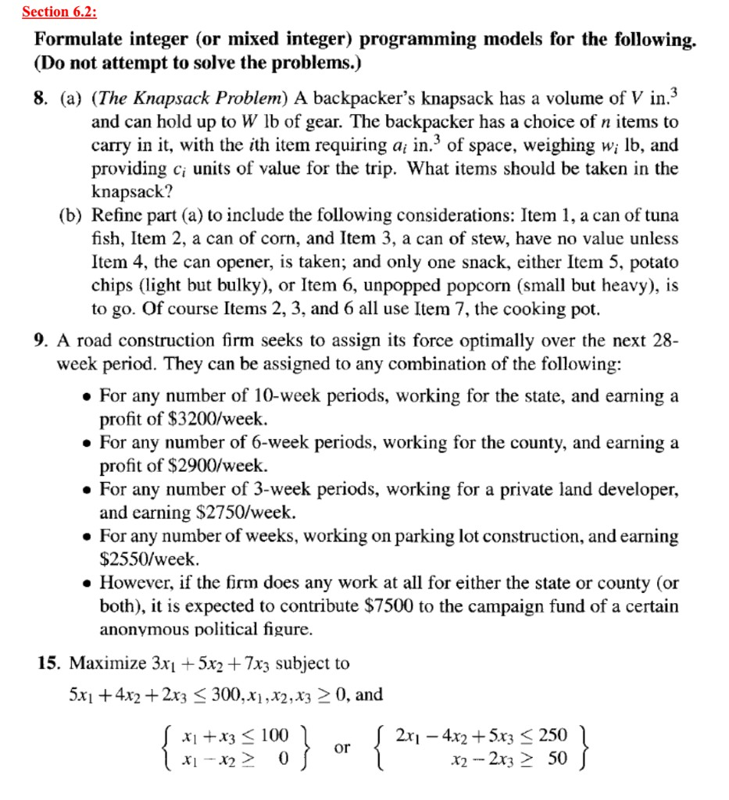
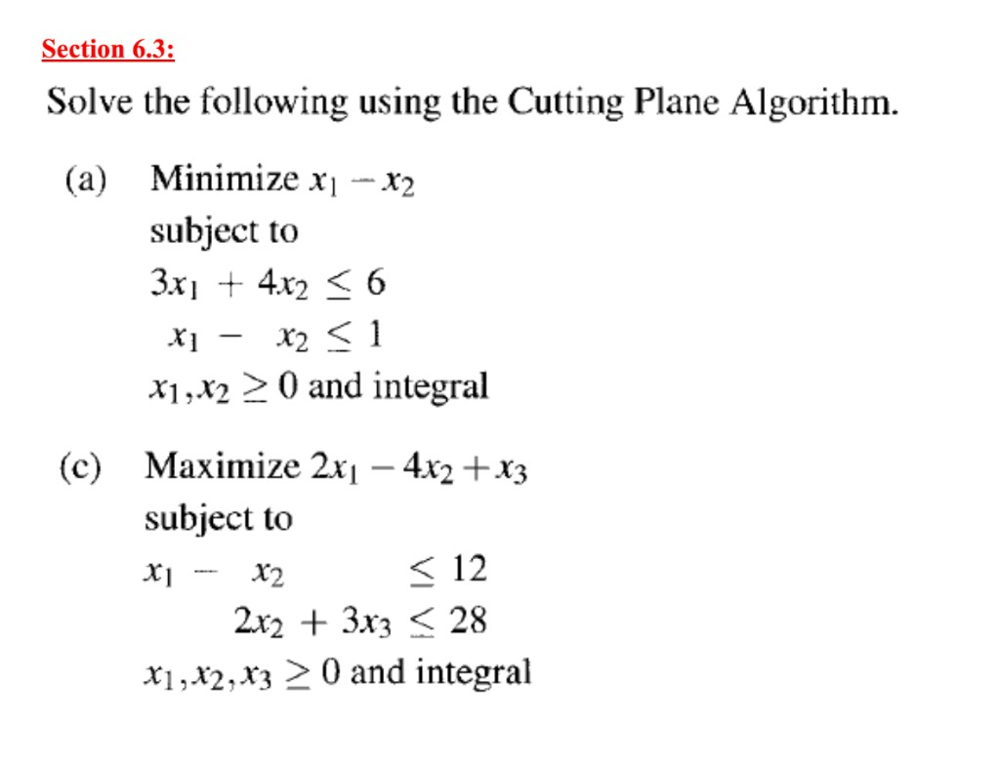

# THQ #8
### By: Ethan Le :D

## Section 6.2

## Question 8

### (a)

Let $x_i \in \{0,1\}$ for $i = 1,\ldots,n$, where $x_i = 1$ if item $i$ is taken and $x_i = 0$ otherwise.

$$
\begin{aligned}
\max\quad & \sum_{i=1}^{n} c_i x_i \\
\text{s.t.}\quad & \sum_{i=1}^{n} a_i x_i \leq V \\
& \sum_{i=1}^{n} w_i x_i \leq W \\
& x_i \in \{0,1\}, \quad i = 1,\ldots,n.
\end{aligned}
$$

### (b)

Same decision variables, objective, and capacity constraints as in (a), plus:

$$
\begin{aligned}
& x_1 \leq x_4, \quad x_2 \leq x_4, \quad x_3 \leq x_4 && \text{(cans need can opener)} \\
& x_5 + x_6 = 1 && \text{(exactly one snack)} \\
& x_2 \leq x_7, \quad x_3 \leq x_7, \quad x_6 \leq x_7 && \text{(items using cooking pot)} \\
& x_i \in \{0,1\}, \quad i = 1,\ldots,n.
\end{aligned}
$$

## Question 9

Let
- $x_s$ = number of 10-week state jobs,
- $x_c$ = number of 6-week county jobs,
- $x_d$ = number of 3-week developer jobs,
- $x_p$ = number of weeks of parking-lot work,
- $y \in \{0,1\}$, where $y = 1$ if any state or county work is done (so the $\$7500$ contribution is paid).

$$
\begin{aligned}
\max\quad & 32000\, x_s + 17400\, x_c + 8250\, x_d + 2550\, x_p - 7500\, y \\
\text{s.t.}\quad & 10x_s + 6x_c + 3x_d + x_p \leq 28 \\
& x_s + x_c \leq 4y \\
& x_s, x_c, x_d, x_p \geq 0 \text{ and integer} \\
& y \in \{0,1\}.
\end{aligned}
$$

(Here $4$ is a valid big-$M$: at most four state/county jobs fit in 28 weeks, e.g. four 6-week county jobs.)

## Question 15

Let $y_1, y_2 \in \{0,1\}$, where $y_1 = 1$ if the first constraint set is enforced and $y_2 = 1$ if the second is enforced.

**Estimating the $M_i$ (slide 24 style).** From the $\leq$ constraints, one variable at a time:

- $x_1 + x_3 \leq 100$ → $x_1 \leq 100$, $x_3 \leq 100$
- $2x_1 - 4x_2 + 5x_3 \leq 250$ → $x_1 \leq 125$, $x_3 \leq 50$
- $5x_1 + 4x_2 + 2x_3 \leq 300$ → $x_1 \leq 60$, $x_2 \leq 75$, $x_3 \leq 150$

Largest caps: $x_1 \leq 125$, $x_2 \leq 75$, $x_3 \leq 150$ (and $x_i \geq 0$). With each set off ($y=0$):

- $M_a$: $x_1 + x_3 - 100 \leq 125 + 150 - 100 = 175$ → $M_a = 175$
- $M_b$: $x_1 - x_2 \geq -M_b$ → $M_b \geq 75 - 0 = 75$ → $M_b = 75$
- $M_c$: $2x_1 - 4x_2 + 5x_3 - 250 \leq 2(125) + 5(150) - 250 = 750$ → $M_c = 750$
- $M_d$: $x_2 - 2x_3 \geq 50 - M_d$ → $M_d \geq 50 - (0 - 2\cdot 150) = 350$ → $M_d = 350$

$$
\begin{aligned}
\max\quad & 3x_1 + 5x_2 + 7x_3 \\
\text{s.t.}\quad & 5x_1 + 4x_2 + 2x_3 \leq 300 \\
& x_1 + x_3 \leq 100 + 175(1 - y_1) \\
& x_1 - x_2 \geq -75(1 - y_1) \\
& 2x_1 - 4x_2 + 5x_3 \leq 250 + 750(1 - y_2) \\
& x_2 - 2x_3 \geq 50 - 350(1 - y_2) \\
& y_1 + y_2 = 1 \\
& x_1, x_2, x_3 \geq 0 \\
& y_1, y_2 \in \{0,1\}.
\end{aligned}
$$

When $y_1 = 1$ (so $y_2 = 0$), the first pair is active and the second is relaxed; when $y_2 = 1$, the reverse holds.

## Section 6.3

## Question (a)

Introduce slack variables $x_3, x_4 \geq 0$:

$$
\begin{aligned}
\min\quad & x_1 - x_2 \\
\text{s.t.}\quad & 3x_1 + 4x_2 + x_3 = 6 \\
& x_1 - x_2 + x_4 = 1 \\
& x_1, x_2, x_3, x_4 \geq 0 \text{ and } x_1, x_2 \text{ integral}.
\end{aligned}
$$

Initial tableau (same layout as Table 6.2; $x_3, x_4$ basic):

$$
\begin{array}{c|cccc|c}
 & x_1 & x_2 & x_3 & x_4 & \\
\hline
x_3 & 3 & 4 & 1 & 0 & 6 \\
x_4 & 1 & -1 & 0 & 1 & 1 \\
\hline
 & 1 & -1 & 0 & 0 & 0
\end{array}
$$

Bottom-row $x_2$ entry is negative → enter $x_2$. Only positive pivot candidate in that column is $4$ → exit $x_3$. Divide the $x_3$ row by $4$, then clear the $x_2$ column in the $x_4$ and $z$ rows:

$$
\begin{array}{c|cccc|c}
 & x_1 & x_2 & x_3 & x_4 & \\
\hline
x_2 & \dfrac{3}{4} & 1 & \dfrac{1}{4} & 0 & \dfrac{3}{2} \\
x_4 & \dfrac{7}{4} & 0 & \dfrac{1}{4} & 1 & \dfrac{5}{2} \\
\hline
 & \dfrac{7}{4} & 0 & \dfrac{1}{4} & 0 & \dfrac{3}{2}
\end{array}
$$

($x_2$ row $= x_3/4$; new $x_4 =$ old $x_4 +$ new $x_2$; new $z =$ old $z +$ new $x_2$.)

LP solution: $(x_1,x_2)=(0,\tfrac{3}{2})$, with $\min = -\tfrac{3}{2}$ (tableau RHS $\tfrac{3}{2}$ is the max-form value of $-x_1+x_2$). Not integer → need a cut next.

**Gomory cut from the $x_2$ row** (slide style: integers on one side, fractional on the other):

**Step 1.** Source equation:
$$
\frac{3}{4}x_1 + x_2 + \frac{1}{4}x_3 = \frac{3}{2}.
$$

**Step 2.** Split each entry as $[\cdot] + f$ (floor + fractional part in $[0,1)$):
$$
\frac{3}{4}=0+\frac{3}{4},\quad
1=1+0,\quad
\frac{1}{4}=0+\frac{1}{4},\quad
\frac{3}{2}=1+\frac{1}{2}.
$$
So
$$
x_2 + \underbrace{\frac{3}{4}x_1 + \frac{1}{4}x_3}_{\text{fractional coeffs}} = 1 + \frac{1}{2}.
$$

**Step 3.** Move integers to the right, fractionals to the left (RHS fractional part stays with the fractional left-hand side):
$$
\frac{3}{4}x_1 + \frac{1}{4}x_3 - \frac{1}{2} = 1 - x_2.
$$
Right-hand side is integer when $x_2$ is integer; left-hand side carries the fractional pieces.

**Step 4.** Name the left-hand side $x_5$ (new slack / cut variable):
$$
x_5 = \frac{3}{4}x_1 + \frac{1}{4}x_3 - \frac{1}{2}.
$$
Since $x_1,x_3\geq 0$, we have $x_5 \geq -\tfrac{1}{2}$. With $x_5$ integer, $x_5 \geq 0$.

**Step 5.** Rewrite with $+1$ coefficient on $x_5$ (tableau-ready cut row):
$$
-\frac{3}{4}x_1 - \frac{1}{4}x_3 + x_5 = -\frac{1}{2}.
$$

Append to the current tableau (zeros under basic $x_2,x_4$ in the new row; $z$ unchanged for now):

$$
\begin{array}{c|ccccc|c}
 & x_1 & x_2 & x_3 & x_4 & x_5 & \\
\hline
x_2 & \dfrac{3}{4} & 1 & \dfrac{1}{4} & 0 & 0 & \dfrac{3}{2} \\
x_4 & \dfrac{7}{4} & 0 & \dfrac{1}{4} & 1 & 0 & \dfrac{5}{2} \\
x_5 & -\dfrac{3}{4} & 0 & -\dfrac{1}{4} & 0 & 1 & -\dfrac{1}{2} \\
\hline
 & \dfrac{7}{4} & 0 & \dfrac{1}{4} & 0 & 0 & \dfrac{3}{2}
\end{array}
$$

**Dual simplex:** all bottom-row $c_j \geq 0$, but $b$ for $x_5$ is negative.

- **Exit:** most negative RHS → $x_5$ ($-\tfrac{1}{2}$).
- **Enter:** among $a_{rj}<0$ in that row, smallest $\lvert c_j/a_{rj}\rvert$:
  - $x_1$: $\lvert(\tfrac{7}{4})/(-\tfrac{3}{4})\rvert = \tfrac{7}{3}$
  - $x_3$: $\lvert(\tfrac{1}{4})/(-\tfrac{1}{4})\rvert = 1$
  → enter $x_3$, pivot on $-\tfrac{1}{4}$.

Divide the $x_5$ row by $-\tfrac{1}{4}$, then clear the $x_3$ column:

$$
\begin{array}{c|ccccc|c}
 & x_1 & x_2 & x_3 & x_4 & x_5 & \\
\hline
x_2 & 0 & 1 & 0 & 0 & 1 & 1 \\
x_4 & 1 & 0 & 0 & 1 & 1 & 2 \\
x_3 & 3 & 0 & 1 & 0 & -4 & 2 \\
\hline
 & 1 & 0 & 0 & 0 & 1 & 1
\end{array}
$$

All RHS $\geq 0$ and bottom row $\geq 0$ → optimal. Integer solution:
$$
(x_1,x_2)=(0,1),\qquad \min\ x_1-x_2=-1.
$$

## Question (c)

Introduce slack variables $x_4, x_5 \geq 0$:

$$
\begin{aligned}
\max\quad & 2x_1 - 4x_2 + x_3 \\
\text{s.t.}\quad & x_1 - x_2 + x_4 = 12 \\
& 2x_2 + 3x_3 + x_5 = 28 \\
& x_1, x_2, x_3, x_4, x_5 \geq 0 \text{ and } x_1,x_2,x_3 \text{ integral}.
\end{aligned}
$$

Initial tableau (bottom row $= -$ max coefficients, same convention as (a)):

$$
\begin{array}{c|ccccc|c}
 & x_1 & x_2 & x_3 & x_4 & x_5 & \\
\hline
x_4 & 1 & -1 & 0 & 1 & 0 & 12 \\
x_5 & 0 & 2 & 3 & 0 & 1 & 28 \\
\hline
 & -2 & 4 & -1 & 0 & 0 & 0
\end{array}
$$

Enter $x_1$ (most negative bottom entry). Pivot on $1$ in the $x_4$ row:

$$
\begin{array}{c|ccccc|c}
 & x_1 & x_2 & x_3 & x_4 & x_5 & \\
\hline
x_1 & 1 & -1 & 0 & 1 & 0 & 12 \\
x_5 & 0 & 2 & 3 & 0 & 1 & 28 \\
\hline
 & 0 & 2 & -1 & 2 & 0 & 24
\end{array}
$$

Enter $x_3$. Pivot on $3$ in the $x_5$ row:

$$
\begin{array}{c|ccccc|c}
 & x_1 & x_2 & x_3 & x_4 & x_5 & \\
\hline
x_1 & 1 & -1 & 0 & 1 & 0 & 12 \\
x_3 & 0 & \dfrac{2}{3} & 1 & 0 & \dfrac{1}{3} & \dfrac{28}{3} \\
\hline
 & 0 & \dfrac{8}{3} & 0 & 2 & \dfrac{1}{3} & \dfrac{100}{3}
\end{array}
$$

LP optimal at $(x_1,x_2,x_3)=\bigl(12,\ 0,\ \tfrac{28}{3}\bigr)$, $z=\tfrac{100}{3}$. Not integer → Gomory cut from the $x_3$ row.

**Gomory cut.** Source row:
$$
\frac{2}{3}x_2 + x_3 + \frac{1}{3}x_5 = \frac{28}{3} = 9 + \frac{1}{3}.
$$
Fractional left, integers right:
$$
\frac{2}{3}x_2 + \frac{1}{3}x_5 - \frac{1}{3} = 9 - x_3.
$$
Let $x_6$ be the cut slack:
$$
-\frac{2}{3}x_2 - \frac{1}{3}x_5 + x_6 = -\frac{1}{3}.
$$

$$
\begin{array}{c|cccccc|c}
 & x_1 & x_2 & x_3 & x_4 & x_5 & x_6 & \\
\hline
x_1 & 1 & -1 & 0 & 1 & 0 & 0 & 12 \\
x_3 & 0 & \dfrac{2}{3} & 1 & 0 & \dfrac{1}{3} & 0 & \dfrac{28}{3} \\
x_6 & 0 & -\dfrac{2}{3} & 0 & 0 & -\dfrac{1}{3} & 1 & -\dfrac{1}{3} \\
\hline
 & 0 & \dfrac{8}{3} & 0 & 2 & \dfrac{1}{3} & 0 & \dfrac{100}{3}
\end{array}
$$

**Dual simplex:** exit $x_6$. Ratios for $a_{rj}<0$:
- $x_2$: $\lvert(\tfrac{8}{3})/(-\tfrac{2}{3})\rvert = 4$
- $x_5$: $\lvert(\tfrac{1}{3})/(-\tfrac{1}{3})\rvert = 1$
→ enter $x_5$, pivot on $-\tfrac{1}{3}$:

$$
\begin{array}{c|cccccc|c}
 & x_1 & x_2 & x_3 & x_4 & x_5 & x_6 & \\
\hline
x_1 & 1 & -1 & 0 & 1 & 0 & 0 & 12 \\
x_3 & 0 & 0 & 1 & 0 & 0 & 1 & 9 \\
x_5 & 0 & 2 & 0 & 0 & 1 & -3 & 1 \\
\hline
 & 0 & 2 & 0 & 2 & 0 & 1 & 33
\end{array}
$$

All RHS $\geq 0$ and bottom row $\geq 0$ → optimal integer solution:
$$
(x_1,x_2,x_3)=(12,\ 0,\ 9),\qquad \max\ 2x_1-4x_2+x_3=33.
$$

